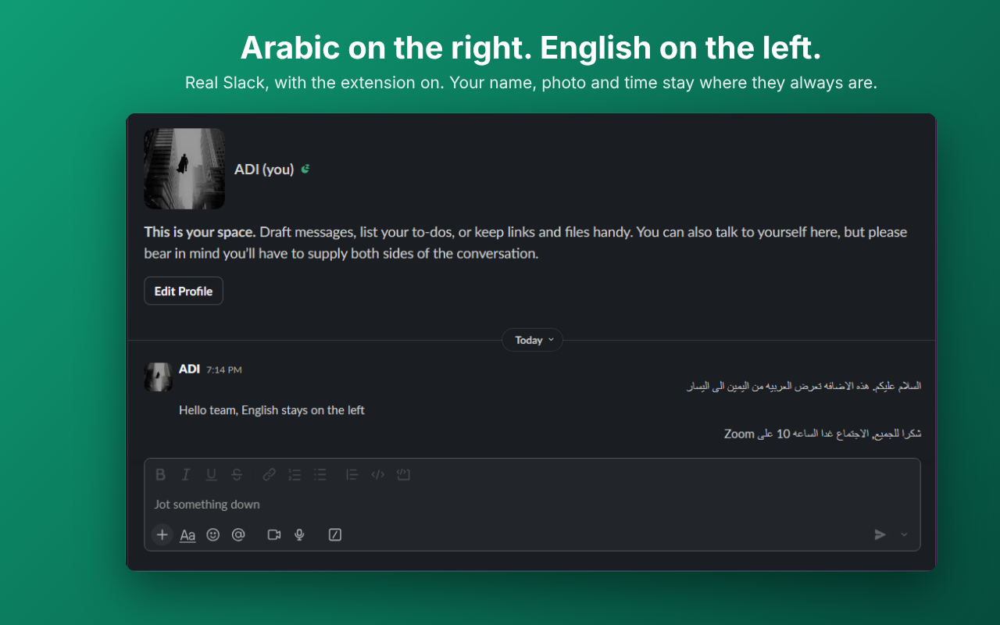

# Arabic RTL for Slack

A free Chrome extension that shows Arabic messages and the message box right-to-left in Slack on the web (app.slack.com). Names, avatars, timestamps and reactions stay where Slack puts them.

إضافة مجانية لمتصفح Chrome تعرض الرسائل العربية وخانة الكتابة من اليمين إلى اليسار في Slack على المتصفح.

## What's here

| Folder | Contents |
| --- | --- |
| `extension/` | The extension itself. Load this folder in `chrome://extensions` with **Load unpacked**. See [extension/README.md](extension/README.md) |
| `tests/` | Direction tests (`node unit.js`) and browser tests on a Slack-like page (`node run.js`, needs Playwright) |
| `store-listing/` | Chrome Web Store text in English and Arabic, screenshots, promo images and the logo |
| `docs/` | The privacy policy, published at https://odayalshareef-jpg.github.io/arabic-rtl-for-slack/ |

## Privacy

The extension collects nothing and sends nothing anywhere. The only thing it stores is the on/off setting. Full policy: [docs/index.html](docs/index.html).

## Problems

If Slack changes its page and the extension stops working, the popup will say it can't find Slack's messages. Please [open an issue](https://github.com/odayalshareef-jpg/arabic-rtl-for-slack/issues). All Slack selectors live in `extension/selectors.js`.

Not affiliated with, endorsed by or sponsored by Slack Technologies, LLC.
